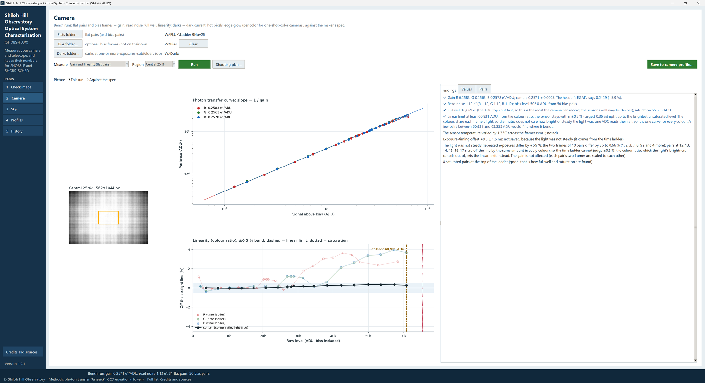

# 1. What SHOBS-FLUX is

SHOBS-FLUX, the Shiloh Hill Observatory Optical System Characterization program, is a desktop program that
**measures your camera and telescope** and keeps the numbers. It works out your camera's gain, read noise, full
well, linear limit and dark current from flats, bias frames and darks on the bench, and your system's zero point,
extinction, seeing, sky brightness and scintillation from ordinary nights at the telescope. Every measurement is
dated and kept, so you can watch your system over months and years.

Most photometry programs ask you to type numbers like these, and most of us type whatever the camera's spec sheet
says. SHOBS-FLUX replaces those guesses with your own system's numbers, and says where each one came from.

You do not need to be a programmer to use it. If you can shoot flats and darks and reduce a night of photometry, you
have everything it needs.

## What it is for

- **Your camera's real numbers.** The spec sheet gives one camera of the model. Yours may differ, and the maker's
  numbers are often for a setting you do not use. A bench run measures your camera at your gain and offset.
- **Exposures that stay linear.** The **linear limit** (the brightest level a pixel can reach and still count light
  in proportion) is the single most important number for photometry. A comp star past it gives a wrong answer with
  no warning. SHOBS-FLUX measures it, and SHOBS-SCHED uses it to choose your exposures.
- **Honest noise estimates.** With a measured zero point, sky, read noise and scintillation, SHOBS-SCHED can say
  before you go whether a transit is within reach, and SHOBS-P's error bars rest on numbers you measured.
- **Watching the system over time.** Is the zero point falling (a dirty mirror, a dewed corrector)? Did the
  collimation help the seeing? The History page answers questions like these from runs you have already made.
- **A record to keep or send.** The system report is one PDF of your telescope and camera: what was measured, how,
  and when.

What it does **not** do:

- **It does not reduce your science frames.** That is SHOBS-P's job. SHOBS-FLUX learns from SHOBS-P's reductions,
  or measures a folder of lights itself, but it makes no light curves.
- **It does not plan nights.** That is SHOBS-SCHED's job.
- **It does not run your camera.** You shoot the flats, darks and lights with ASIAIR, NINA or whatever you use;
  SHOBS-FLUX reads the files afterwards. The **Shooting plan** tells you what to shoot.
- **It does not need the internet**, except for the Sky page's catalog magnitudes (APASS DR9 and Gaia DR3, from
  VizieR) and the once-a-day check for a new version.

## The window

SHOBS-FLUX has one main window. The blue sidebar on the left reads **Shiloh Hill / Observatory / Optical System /
Characterization**, with **(SHOBS-FLUX)** under it and the line *Measures your camera and telescope, and keeps
their numbers for SHOBS-P and SHOBS-SCHED*. Below that are the five pages, and at the bottom **Credits and sources**
and the version number (**Version 1.0.0**).

The white area on the right is the page you are working on. Every page has its title at the top and a short line
under it saying what the page is for. Most pages are split in two: a picture on the left (the frame, a plot) and,
on the right, the results as tabs (**Findings**, **Values**, and on the Camera page **Pairs**). You can drag the
divider between the two halves.

Along the bottom runs the **status strip**. Its first line holds the latest news; when SHOBS-FLUX starts it names
your data folder (*Data folder: C:\Users\…\.shobs*). Its second line is a short credits line. While the program is
working, a green busy bar appears at the lower left of the status strip; chapter 10 explains it.

SHOBS-FLUX always opens on the Check image page.

## The five pages

The pages are not steps to work through in order. You will visit the Camera page a few times a year, the Sky page after nights you reduce, and the others when you want to look something up.

| Page | What you do there |
|---|---|
| **1 Check image** | Open any one frame: the sky in electrons, whether the exposure is sky- or read-noise-limited, saturated stars and stars over the linear limit, each star's electrons, SNR and size. Your first look at any new setup. |
| **2 Camera** | Bench runs. Flat pairs and bias frames give the **gain**, **read noise**, **full well** and **linear limit**; darks give the **dark current**, hot pixels and edge glow. **Save to camera profile…** keeps them. |
| **3 Sky** | On-sky runs, from SHOBS-P's on-sky logs or a folder of lights: **zero point**, **extinction**, **seeing**, **sky brightness**, **scintillation** and the time between frames, each night judged. **Save to system profile…** keeps them. |
| **4 Profiles** | The camera and system profiles SHOBS-P and SHOBS-SCHED read, value by value with its source. Type a value, roll back to an earlier revision, see the maker's spec curves, copy the values for AstroImageJ, EXOTIC or HOPS. |
| **5 History** | Any value of any setup over time, with error bars, a before / after split around an event (a cleaning, a collimation), PNG and CSV export, and the **System report**. |

Every page is covered in Part 2 of this manual.

## Profiles: what SHOBS-FLUX keeps

SHOBS-FLUX keeps its results in **profiles**, small files in the SHOBS data folder that all three SHOBS programs
share.

- A **camera profile** describes one camera at one gain, offset and binning: gain, read noise, bias level, full
  well, saturation, linear limit, dark current and the exposure-timing offset. The ASI2600MC at gain 100, offset 50,
  bin 1 is one camera
  profile; the same camera at gain 0 would be another.
- A **system profile** describes one telescope with one camera: focal length, plate scale, and per band the zero
  point, extinction, seeing, sky brightness and scintillation.

A profile is only ever changed when you press a **Save** button, and every save keeps the revision before it, so
nothing is ever lost (chapter 8).

## Where every number came from

Every value SHOBS-FLUX shows carries a small tag saying where it came from:

| Tag | Meaning |
|---|---|
| **measured** | SHOBS-FLUX measured it from your frames. |
| **header** | Read from the frame's FITS header (EGAIN, CCD-TEMP, FOCALLEN…). |
| **spec** | The camera maker's figure, from the spec curves for your gain setting. |
| **estimate** | A rough starting value, used only until something better is known. |
| **you** | You typed it. A run you save replaces it, unless you tick **Keep the values you typed yourself** in the Save window. |
| **worked out** | Calculated from other values (full well from the gain and the saturation level, say). |
| **—** | Not known yet. |

The tags matter. A *spec* read noise is the maker's best camera; a *measured* one is yours. When SHOBS-SCHED says a
transit is *Detectable* it is because the numbers behind it are *measured*; with *estimate* numbers it says
*Detectable?*, with a question mark.

## SHOBS-FLUX, SHOBS-P and SHOBS-SCHED

SHOBS-FLUX's sister programs are [SHOBS-P](https://github.com/SHOBS-S/SHOBS-P), which reduces your frames, and
[SHOBS-SCHED](https://github.com/SHOBS-S/SHOBS-SCHED), which plans your nights.

- **SHOBS-FLUX works on its own.** You do not need either of the others. A folder of flats gives you a camera
  profile, and a folder of lights gives you a system profile.
- **SHOBS-P feeds it.** SHOBS-P 2.2.19.1 and later writes an **on-sky log** after every reduction: each star's
  light, the sky, the airmass, the seeing. The Sky page reads these logs, so every night you reduce counts towards
  your zero point and extinction without your doing anything more.
- **SHOBS-SCHED reads it.** SHOBS-SCHED 1.4.0 and later picks each target's exposure from the camera profile's
  linear limit and works out the S/N from the system profile's zero point, sky, read noise and scintillation.
- **SHOBS-P will read it.** SHOBS-P 2.4.0 is planned to take its linear limit from the camera profile (until then,
  type the same limit in SHOBS-P's settings).
- **The data folder is shared**, but each program owns its own files. SHOBS-FLUX is the only one that writes the
  profiles.

## How to use this manual

- **Part 1** (chapters 1 to 3) gets you installed and through a first session: one frame, a bench run, and a Sky run.
- **Part 2** (chapters 4 to 9) covers each page in turn, every field and button.
- **Part 3** is reference: the busy bar and messages, credits, troubleshooting, and a glossary.

Button names and other words you see on the screen are printed in **bold**, exactly as the program shows them.
Messages are printed in *italics*. The examples and screenshots come from the Shiloh Hill Observatory: a 14-inch
iOptron RC (focal length about 2,900 mm) with a ZWO ASI2600MC Air color camera at gain 100, offset 50.

> **Tip:** If you are in a hurry, go straight to [3. Your first session, step by step](03-first-session.md).

---

Previous: [Contents](README.md) · Next: [2. Installing and starting](02-installing.md)
