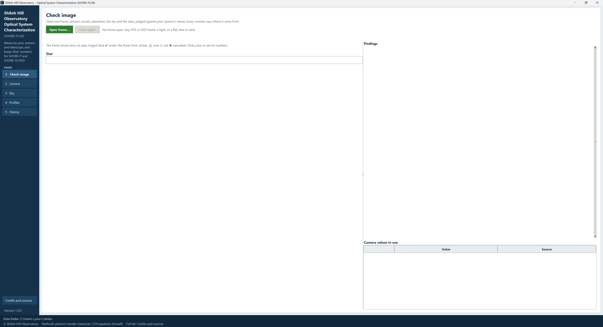

# 2. Installing and starting

SHOBS-FLUX is a Python program. You install Python once, unzip SHOBS-FLUX, and run one file that sets everything
else up. It takes a few minutes, most of it waiting for downloads. If you already run SHOBS-P or SHOBS-SCHED, it
works the same way.

## What you need

- **Windows 10 or 11, Linux, or a Mac.** SHOBS-FLUX comes with start files for all three. It has been used on
  Windows; the Linux and Mac start files are the same ones SHOBS-P uses, but SHOBS-FLUX itself has not yet been
  tried on Linux or a Mac by a user (see "Linux and the Mac" below).
- **Python 3.11 or newer, with Tkinter** (the window toolkit). Python from python.org includes it. On Windows,
  Anaconda or Miniconda also works.
- **Room for your frames.** SHOBS-FLUX reads your flats, darks and lights where they are; it never copies them.
- **An internet connection** for the install, and later for the Sky page's catalog magnitudes. Everything else works
  without one.

SHOBS-FLUX uses four packages on top of Python: **NumPy**, **SciPy**, **Astropy** (FITS files, sky coordinates and
the catalog questions) and **Matplotlib** (every plot). The setup installs them for you.

## Install Python (Windows)

1. Go to [python.org/downloads](https://www.python.org/downloads/) and download the latest Python for Windows.
2. Run the installer. On the first screen, tick **Add python.exe to PATH**.
3. Click **Install Now** and wait for it to finish.

> **Tip:** If you already have Python 3.11 or newer (for SHOBS-P or SHOBS-SCHED, say), you can skip this.
> SHOBS-FLUX tries each Python it finds and uses the first one that works, Tkinter included. Your Python itself is
> left as it is.

## Install SHOBS-FLUX on Windows

1. Unzip SHOBS-FLUX somewhere permanent, for example `C:\Astro\shobs_flux`. Avoid your Downloads folder: the
   shortcuts point at this folder, so it should not move.
2. Open the folder. It holds files such as `flux_app.py`, `Create shortcuts.bat`, `Run self-test.bat`,
   `run_windows.bat` and `README.md`.
3. Double-click **Create shortcuts.bat**. A black window opens. The first time it:
   - says `Looking for a Python that can run SHOBS-FLUX...` and lists each Python it tries, with `usable:` beside
     the one that works, or `not usable:` and the reason for the others;
   - sets up SHOBS-FLUX's own Python environment in `%LOCALAPPDATA%\SHOBS-FLUX\python-env` (made from that Python,
     which is left untouched);
   - installs NumPy, SciPy, Astropy and Matplotlib there;
   - makes a **SHOBS-FLUX** icon on the Desktop and in the Start menu.
4. When it says `Done. Start SHOBS-FLUX from the Desktop icon or the Start menu.`, press any key to close the window.

If the window says `SHOBS-FLUX could not find a Python it can use`, every Python it tried is listed above that line
with the reason. Install Python from python.org (tick **Add python.exe to PATH**) and run **Create shortcuts.bat**
again. If it says `The shortcuts could not be made. Leave this window open and copy the message above.`, the lines
above it say why.

> **Tip:** To pin SHOBS-FLUX to the taskbar, open the Start menu, right-click **SHOBS-FLUX** and choose **Pin to
> taskbar**.

If you ever move the SHOBS-FLUX folder, run **Create shortcuts.bat** again so the shortcuts point at the new place.

## Check the install with the self-test

1. In the SHOBS-FLUX folder, double-click **Run self-test.bat** (on Linux or a Mac, see below).
2. Wait for it to finish. A SHOBS-FLUX window may open and close by itself; that is part of the test.
3. The last result line should read `ALL PASSED`.

The test makes its own synthetic frames (flat ladders, darks, nights of stars) in a temporary folder and measures
them, so it needs none of your data and changes none of it. Its sections are:

| Section | What it checks |
|---|---|
| 1 Environment | Your Python and its packages. |
| 2 Shared profile code | `shobs_profile.py` (the profile code SHOBS-FLUX shares with SHOBS-P and SHOBS-SCHED) and its example profiles. |
| 3 Reading frames and Check image | FITS and XISF reading, and the Check image measurements on synthetic frames. |
| 3b The bench run | Gain, read noise, full well and linear limit from synthetic flat-pair ladders. |
| 3c The dark run and the spec curves | Dark current from synthetic darks; the maker's spec curves. |
| 3d On-sky | Zero point, extinction, seeing and the rest from synthetic nights. |
| 4 Run history, 4b History, roll-back and the system report | The run history database, the trend plots, profile roll-back, the PDF report. |
| 5 The window | Every page, with the network switched off. It says `SKIP` when there is no screen. |
| 6 Your SHOBS data folder | Read only: how many camera and system profiles, spec files, history revisions and on-sky logs you have, and which on-sky log formats. |

Each check is marked `PASS` or `FAIL`. The log is written to `selftest_log.txt` in the SHOBS-FLUX folder, and a copy
to `SHOBS-FLUX_selftest_log.txt` in your Downloads folder. If you ever report a problem, attach this file. Chapter
12 has more.

## Start SHOBS-FLUX

Double-click the **SHOBS-FLUX** icon on the Desktop, or choose it from the Start menu. The program opens without a
console window, on the **Check image** page, and the status strip names your data folder.

### Other ways to start

**run_windows.bat** starts SHOBS-FLUX with a black console window beside it, using the same Python as the shortcuts,
and checks the packages first. Use it when the program will not start from its icon: the console shows the error,
and the window stays open with `The app did not start. Leave this window open and copy the message above.`

### Linux and the Mac

SHOBS-FLUX comes with start files for Linux and the Mac. They do the same job as **Create shortcuts.bat**: find a
Python that can run SHOBS-FLUX, give SHOBS-FLUX its own Python environment, install the packages, and start the
program.

> **Note:** These start files are shared with SHOBS-P, where they have been used on Linux and on a Mac. SHOBS-FLUX
> itself has not yet been tried on either by a user. If something does not work, please report it (chapter 12).

**Install Python.**

- **Mac:** install Python from [python.org/downloads/macos](https://www.python.org/downloads/macos/) (it includes
  Tk). When it has installed, run **Install Certificates.command** in its folder under Applications (the catalog
  questions need it).
- **Linux:** Python 3.11 or newer with Tkinter. If it is missing, the start file names the package for your system
  (on Debian or Ubuntu, `sudo apt install python3-tk`).

**Start SHOBS-FLUX.**

- **Mac:** double-click **Start SHOBS-FLUX.command**. The first time, macOS may refuse to open a file from a
  downloaded zip. Then Control-click (or right-click) it, choose **Open**, and **Open** again. The environment goes in
  `~/Library/Application Support/SHOBS-FLUX/python-env`. Keep the Terminal window open while SHOBS-FLUX runs.
- **Linux:** in a terminal, in the SHOBS-FLUX folder, type `./run_linux.sh`. The environment goes in
  `~/.local/share/SHOBS-FLUX/python-env`. `./run_linux.sh --desktop` adds SHOBS-FLUX to your applications menu, with
  its icon (no sudo needed).

The first time, it says `Looking for a Python that can run SHOBS-FLUX...` and lists each Python it tries, as on
Windows; later starts reuse the environment. If it ends with `SHOBS-FLUX could not find a Python it can use`, the
lines above say why each one failed.

**The self-test.** On a Mac, double-click **Run self-test.command**. On Linux, type `./run_linux.sh --selftest` (or
`./run_selftest.sh`). The log goes to the same two places as on Windows.

## Where SHOBS-FLUX keeps your things

Everything SHOBS-FLUX measures is kept in the **SHOBS data folder**, `.shobs` in your user folder
(`C:\Users\<you>\.shobs` on Windows, `~/.shobs` elsewhere). SHOBS-P and SHOBS-SCHED read from the same folder. An
update never touches it.

| Folder or file | What it holds |
|---|---|
| `cameras\` | Camera profiles: one per camera, gain, offset and binning. |
| `systems\` | System profiles: one per telescope and camera, with values per band. |
| `specs\` | The makers' camera curves (gain, read noise and full well against the gain setting; dark current against temperature), your own copies of them. |
| `history\` | Every earlier revision of every profile (Roll back… uses these). |
| `onsky\` | The on-sky logs: one file per SHOBS-P reduction, and those of folder runs on the Sky page. |
| `cache\` | Saved catalog answers from VizieR (kept 30 days), so a field asked for once works offline. |
| `flux_runs.sqlite` | The run history: every bench, dark, Sky and Check image run, for the History page. |
| `flux_settings.json` | SHOBS-FLUX's own settings: the last folders used, your answers to header questions, the new-version check. |
| `flux.log` | What SHOBS-FLUX did, and any error with its details (chapter 12). |

The name starts with a dot, so Windows Explorer may hide it. Type `%USERPROFILE%\.shobs` into the Explorer address
bar to go straight there, or press **Open the data folder** on the Profiles page.

The Python environment is separate again: it holds only Python and its packages, in `%LOCALAPPDATA%\SHOBS-FLUX` on
Windows, `~/Library/Application Support/SHOBS-FLUX` on a Mac and `~/.local/share/SHOBS-FLUX` on Linux.

> **Tip:** Back up the `.shobs` folder now and then. It holds every measurement you have made; your frames can be
> measured again, but the dates and the history are easier to keep than to rebuild.

## Is there a new version?

When SHOBS-FLUX starts it asks GitHub, in the background and at most once a day, whether a newer release is out. If
one is, a note at the right of the status strip says so, with the release's first highlight when its notes have
some (for example *SHOBS-FLUX 1.0.2 is available: … — click for details*; on a narrow window just *… is available —
click for details*). Click the note: a small **New version** window gives the version and its date, what's new, an
**Open release page** button (the zip and the manual are there) and **Close**. A release with no highlights opens its
release page straight away (*… is available — see the release notes*).

Nothing about you or your data is sent (only the program's name and version), nothing is downloaded or installed, and
it says nothing when there is no internet. You can switch it off on the **Credits and sources** page (**Check for new
versions at start**).

To get an email for each release instead, open the SHOBS-FLUX page on GitHub and choose **Watch → Custom →
Releases**, or follow the feed `https://github.com/SHOBS-S/SHOBS-FLUX/releases.atom`.

## Updating to a new version

1. Unzip the new version, over the old folder or beside it.
2. On Windows, double-click **Create shortcuts.bat** in the new folder. It points the shortcuts at it and installs
   any new packages the new version needs. On Linux or a Mac, just start the new version with its start file.
3. Run the self-test once.

Your profiles, history and settings stay where they are, in the `.shobs` folder.

---

Previous: [1. What SHOBS-FLUX is](01-what-it-is.md) · Next: [3. Your first session, step by step](03-first-session.md)
