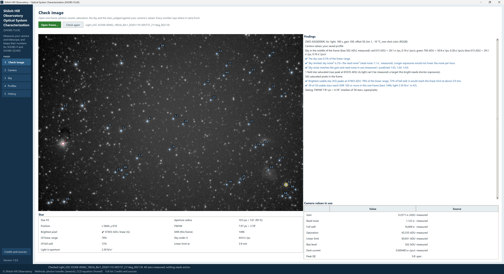
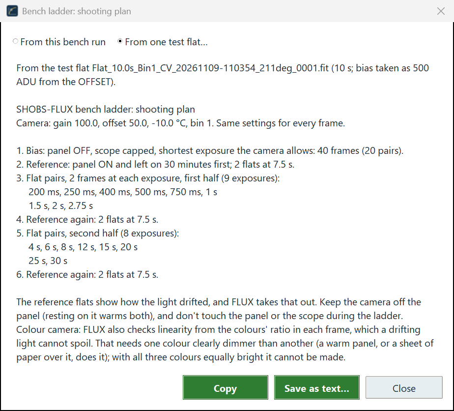
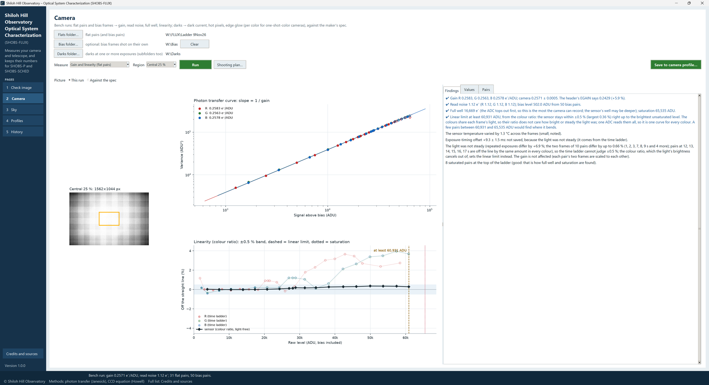
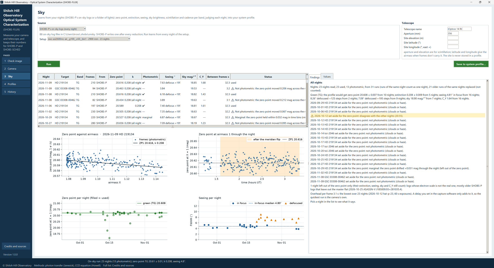

# 3. Your first session, step by step

This chapter takes you from a fresh install to a camera profile and a system profile that SHOBS-SCHED (and, from
2.4.0, SHOBS-P) can use. It follows the order most people take: look at one frame, measure the camera on the bench,
then let your nights measure the telescope and the sky. Each step is covered fully in Part 2; here you only need the
buttons.

You can stop after any step. Even step 1 alone gives SHOBS-SCHED a starting camera profile to work from.

## Step 1: look at one frame

1. Start SHOBS-FLUX. It opens on the **Check image** page.
2. Press **Open frame…** and pick one of your lights: an ordinary frame from a night of photometry, as it came off
   the camera (not calibrated, not stacked).
3. A moment later the frame appears on the left with its stars ringed, and the right-hand side fills in:
   - the **sky** in electrons per pixel (and per second), for each color on a one-shot-color camera;
   - whether the exposure is **sky-limited** or **read-noise-limited**;
   - how many pixels are **saturated**, and which stars are **over the linear limit** or saturated;
   - for each star, its light in **electrons**, its **SNR** and its **FWHM** (or the size of a defocused donut);
   - the exposure at which the brightest star would reach the linear limit.
4. Click a star on the frame for its own numbers, shown in the **Star** box under the picture.

The first time, SHOBS-FLUX has no camera profile for your camera, so the camera values come from the frame's header
(**header**) and the maker's spec (**spec**). Press **Save as starting camera profile** to keep them. That gives
SHOBS-SCHED something to start from until the bench run below measures the real values.

Chapter 4 explains every line.

## Step 2: measure the camera on the bench

The bench run needs **flat pairs**: two flats at each of 10 to 20 exposures, from very short to past saturation, of
a steady light (a flat panel). It also needs **bias pairs**, two or more bias frames, in the same folder or a folder
of their own. SHOBS-FLUX tells you exactly what to shoot:

1. Open the **Camera** page. Leave **Measure** at **Gain and linearity (flat pairs)**.
2. Press **Shooting plan…**, choose **From one test flat…** and pick one flat you have shot of your panel. The plan
   lists the exposures to shoot, the reference exposure to repeat at the start, the middle and the end, the
   30-minute warm-up and the bias frames.
3. Shoot the ladder with your capture program, into one folder.

Then measure it:

4. Press **Flats folder…** and pick the ladder's folder. If your bias frames are in a folder of their own, press
   **Bias folder…** and pick it.
5. Leave **Region** at **Central 25 %** and press the green **Run**. The busy bar runs at the lower left of the
   status strip while SHOBS-FLUX works through the pairs.
6. When it is done, the status strip gives the headline: for example *Bench run: gain 0.2571 e⁻/ADU, read noise
   1.12 e⁻; 31 flat pairs, 50 bias pairs.* The **Findings** tab says what was measured and how well; the **Values**
   tab lists every value beside the profile's value now; the **Pairs** tab lists every flat pair.
7. Press **Save to camera profile…**. A window shows each value, the profile's value **Now** and the **Measured**
   value that replaces it. Press **Save**. The status strip says *✔ Camera profile … saved.*

Chapter 5 explains the run: the linear limit, the two ways of finding it (the colors' ratio and the time ladder),
what an unsteady panel looks like, and the gain in your FITS header.

> **Tip:** The dark current can wait. When you have a dark library, set **Measure** to **Dark current (darks)**,
> press **Darks folder…**, **Run**, and **Save to camera profile…** (chapter 6).

## Step 3: let your nights measure the telescope

The Sky page learns the zero point, extinction, seeing, sky brightness and scintillation from nights you have
already shot. If you use SHOBS-P 2.2.19.1 or later, you need do nothing new: every reduction leaves an on-sky log
in the data folder.

1. Open the **Sky** page. Leave the source at **SHOBS-P's on-sky logs (every night)**. The line under it says how
   many logs it found.
2. If the logs hold more than one telescope or camera setting, pick yours under **Setup**.
3. Under **Telescope**, type its name (for example *iOptron 14 RC*), its **Aperture (mm)** and your **Site
   elevation (m)**. The aperture and elevation are for scintillation; latitude and longitude are only needed when
   your frames do not carry the airmass. The site is never stored in a profile.
4. Press the green **Run**. When it is done, the status strip gives the headline: for example *On-sky run: 23 nights
   (13 photometric); zero point TG 20.61 ± 0.01, k 0.208, seeing 4.8″.*
5. The list of nights says how each night was judged: **photometric** (its zero point held steady), not photometric
   (it still counts for seeing, sky and scintillation), or set aside, and why. Pick a night for its own findings and
   pictures.
6. Press **Save to system profile…**, check the changes, and press **Save**. The status strip says *✔ System profile
   … saved.*

No SHOBS-P? Choose **A folder of lights** instead and pick one night's lights of a field with catalogued stars;
SHOBS-FLUX measures them itself. Chapter 7 has both.

## Step 4: see what you have

Open the **Profiles** page. Pick your camera profile, then your system profile: every value with its source tag,
its date and the run it came from. From now on:

- **SHOBS-SCHED** reads the linear limit for its exposures, and the zero point, sky, read noise and scintillation
  for its S/N and verdicts, which lose their "?" (chapter 8).
- **Every night you reduce in SHOBS-P** adds an on-sky log. Run the Sky page again now and then (after a few new
  nights) and save, and your zero point, extinction and seeing keep up with your system.
- **The History page** shows any of these values over time (chapter 9).

---

Previous: [2. Installing and starting](02-installing.md) · Next: [4. Check image](04-check-image.md)
