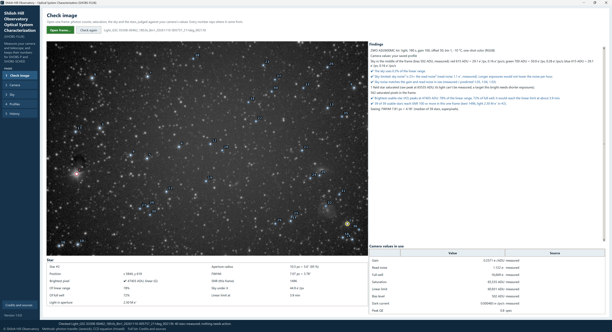

# 4. Check image

The Check image page looks at **one frame** and tells you what it holds in the units that matter for photometry:
electrons, not grey levels. Use it on the first frame of a new setup, on a frame from a night that went oddly, or
whenever you want to know whether an exposure was right.

It needs no calibration frames. It works on the frame as the camera wrote it.

## Opening a frame

Press **Open frame…** and pick any **FITS** (`.fits`, `.fit`, `.fts`) or **XISF** frame: a light, or a flat, bias or
dark. The line beside the button names the file. SHOBS-FLUX remembers the folder for next time.

**Check again** measures the same frame again. Use it after you have changed the camera profile (on the Profiles
page, or by saving a bench run), so the frame is judged with the new values.

The busy bar runs at the lower left while the frame is read and measured. A large frame from a 26-megapixel camera
takes a few seconds. When it is done, the status strip says how many stars were measured.

## The picture

The frame appears on the left with a gentle stretch so the stars show. The brightest stars (up to 40) are ringed
and numbered, each ring in its status color:

| Ring | Meaning |
|---|---|
| **blue** (✔) | The star's brightest pixel is under the linear limit: good for photometry. |
| **amber** (⚠) | Over the linear limit but not saturated: fine to look at, not for photometry. |
| **red** (✖) | Saturated: its light cannot be measured. |

Click a star (or near it) and the **Star** box under the picture fills in:

| Line | What it is |
|---|---|
| **Position** | Its x and y on the frame, in camera pixels. |
| **Brightest pixel** | Its brightest raw pixel in ADU (bias included, as SHOBS-P counts raw peaks), with ✔ *linear*, ⚠ *over linear* or ✖ *saturated*, and which color it was in. |
| **Of linear range** | How far that pixel is from the bias to the linear limit. 80 % is getting close. |
| **Of full well** | The same as a share of the full well. |
| **Light in aperture** | The star's light in electrons, in an aperture that holds 95 % of it. |
| **Aperture radius** | That aperture's radius, in pixels and arcseconds. |
| **FWHM** or **Shape** | The star's size, or *defocused (donut)* for a defocused star. |
| **SNR (this frame)** | The star's signal-to-noise in this one frame. |
| **Sky under it** | The sky in electrons per pixel around it. |
| **Linear limit at** | The exposure at which this star's brightest pixel would reach the linear limit. |

The selected star gets an extra yellow ring.

## The Findings

The **Findings** box on the right is a list of lines, top to bottom. A line with **✔** is good news, **⚠** needs
your attention, **✖** is a problem with the frame itself. A line with no icon is a plain note. Every line carries
its icon as well as its color.

**The frame.** The first line names the camera and the frame: kind (light, flat, bias, dark), exposure, gain,
offset, binning, sensor temperature, one-shot color with its Bayer pattern or mono, and the filter. Then any notes
about the header: *The header has no FOCALLEN or XPIXSZ* (sizes are then in pixels only), *The header has no
INSTRUME or GAIN* (a saved camera profile cannot be matched to it), and which camera values are in use: *your saved
profile* or *no saved profile yet: header and spec values*.

**The sky** (lights). *Sky in the middle of the frame* gives the bias level and, for each color, the sky in ADU, in
electrons per pixel and in electrons per pixel per second. Then:

- **How much of the linear range the sky uses.** Under a quarter is ✔. A quarter to a half is a plain note
  (shorter exposures leave the stars more room). Over half is ✖: there is little room left for the stars.
- **Sky- or read-noise-limited.** When the sky's own noise swamps the read noise (*✔ Sky-limited: sky noise² is
  …× the read noise²*), a longer exposure would not lower the noise per hour. When it does not (*⚠
  Read-noise-limited*), faint stars gain from longer exposures or binning. The faintest color decides.
- **The noise check.** When the bias level is known, SHOBS-FLUX compares the sky's measured noise with what the gain
  and read noise in use predict. *✔ Sky noise matches the gain and read noise in use* is a good sign the gain is
  right; *⚠ Sky noise does not match …* means the gain (e⁻/ADU) in use is probably wrong.

The bias level comes from the camera profile when it has a measured one. Otherwise it is worked out from the sky
noise, and the line says so (*worked out from the sky noise, approximate: bias frames will measure it*).

**The stars.** How many field stars are saturated or over the linear limit (plain notes: a few bright field stars
are normal; a *target* that bright needs shorter exposures), or *✔ All 40 brightest stars stay under the linear
limit*. Saturated pixels outside the stars measured (hot pixels). Then the most useful line on the page: *✔
Brightest usable star (#…) peaks at … ADU: …% of the linear range, …% of full well; it would reach the linear limit
at about … s*. Then how many stars reach SNR 100 in this one frame, and the seeing (*FWHM … px = …″*) or, for a
defocused frame, *Defocused (donut stars): 95 %-light diameter … px*.

**Calibration frames.** For a flat, the levels of each color in the middle of the frame and whether they sit well
inside the linear range (*✔ Flat level fine*, *⚠ … close to the top*, *⚠ The faintest color is only …% of the linear
limit: noisy*). For a bias or dark, its levels. Bias and darks are measured properly on the Camera page.

> **Tip:** The linear limit used here is the camera profile's. Until a bench run has measured it, it is the
> spec's or an estimate, and the lines say so. Chapter 5 measures the real one.

## Camera values in use

Under the Findings, **Camera values in use** lists the values the page judged the frame with: gain, read noise,
bias level, saturation, linear limit, full well, dark current and the others, each with its **Source** (*measured*,
*header*, *spec*, *estimate*, *you*, *worked out*; chapter 1). When a camera profile matches the frame's camera, gain,
offset and binning, its values are used. Otherwise they come from the header and the maker's spec.

If the frame's sensor temperature differs from the one the dark current was measured at, the dark current is read
at the frame's own temperature from the dark run's curve (chapter 6).

## Save as starting camera profile

When no camera profile matches the frame, a green **Save as starting camera profile** button appears at the top
right. It makes a profile for this camera, gain, offset and binning from the header and spec values, so SHOBS-SCHED
has something to work with. The message says *✔ Saved camera profile … Its values are labelled header / spec /
estimate until bench runs measure them; type your own on the Profiles page.*

If the frame's header does not name the camera (no INSTRUME), SHOBS-FLUX asks what it is called, once, and uses
your answer for every frame without one.

## Stacked and stretched images

A **processed image** (stacked, calibrated or stretched by other software) is recognised. The Findings open with
*This is a processed image (…), not a frame as the camera wrote it*. Its stars and their sizes are still measured,
but electrons, saturation and the linear limit are not judged on it, since the numbers no longer mean what the
camera's did. For photometry questions, open a single raw light.

## How it measures

- One-shot-color frames are measured on **superpixels**: each the sum of one 2×2 Bayer cell, four real pixels.
  Brightest pixels are read on the real pixels, per color.
- The sky is a clipped median (so the stars do not count) of the middle of the frame, half its width and half its height, for each color.
- Each star's light is the sum in an aperture holding 95 % of a star of its measured size, less the sky around it.
- Nothing is changed on disk. Each check is kept in the run history (the History page lists it).

---

Previous: [3. Your first session, step by step](03-first-session.md) · Next: [5. Camera: the bench run](05-bench-run.md)
