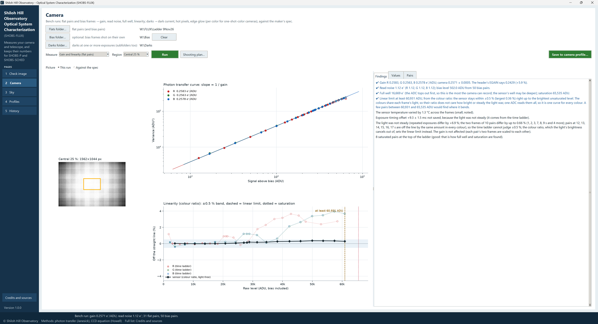
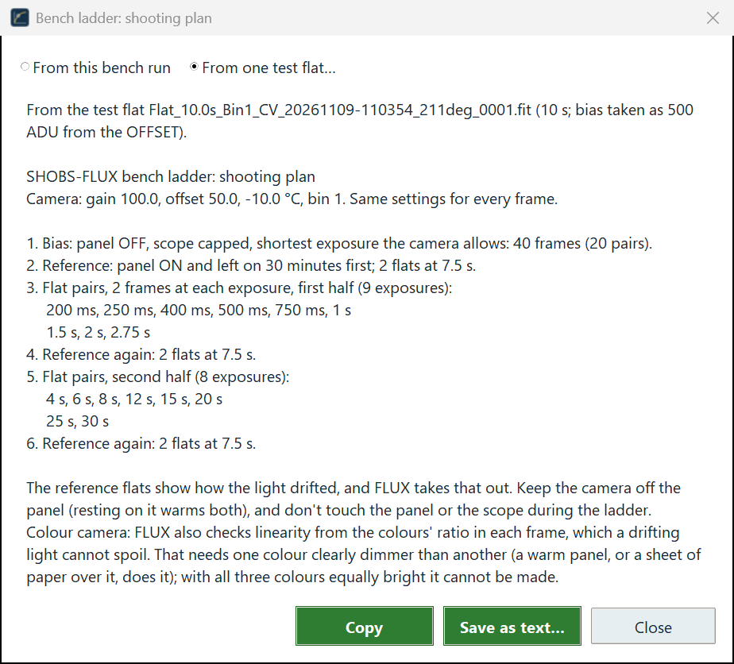
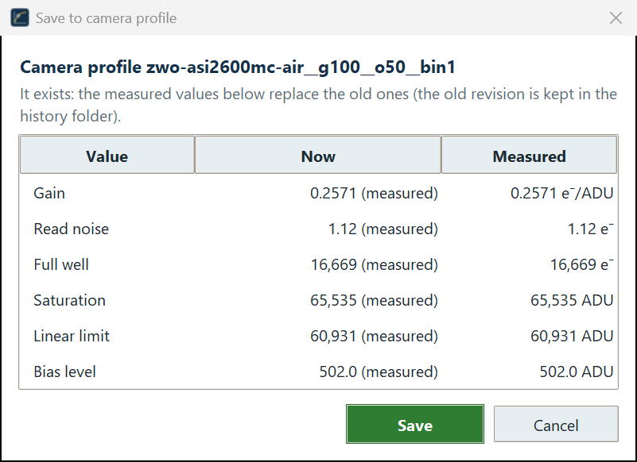

# 5. Camera: the bench run

The bench run measures your camera from **flat pairs** and **bias pairs**: its **gain**, **read noise**, **bias
level**, **full well**, **saturation**, **linear limit** and **exposure-timing offset**. For a one-shot-color camera
it measures each color (red, green, blue; the two greens together) as well as the camera as a whole.

You need a steady light (a flat panel, or a lightbox) and about an hour, most of it the panel warming up. You do it
once for each gain setting you use, and again now and then (once a year, or after anything happens to the camera).

## What to shoot: the Shooting plan

A good ladder has flats at 15 to 20 or so exposures (a run needs at least 4 different ones), spaced from very short (a percent of the range) to a little past
saturation, with a few extra near the top where linearity bends. Two flats at each exposure make a **pair**. The
right exposures depend on how bright your panel is, so let SHOBS-FLUX work them out:

1. Shoot **one test flat** of your panel at your usual gain and offset, at any exposure that is not saturated.
2. On the **Camera** page, set **Measure** to **Gain and linearity (flat pairs)** and press **Shooting plan…**.
3. In the **Bench ladder: shooting plan** window, choose **From one test flat…** and pick it. (After a run, choose
   **From this bench run** to plan the next ladder from the run on screen instead.)

The plan opens with what it was worked out from (*From the test flat … (10 s; bias taken as 500 ADU from
the OFFSET)*) and the camera settings to keep, then reads like this (your exposures will differ):

1. **Bias:** panel off, scope capped, the shortest exposure the camera allows, 40 frames (20 pairs).
2. **Reference:** panel on and left on 30 minutes first; 2 flats at the reference exposure.
3. **Flat pairs**, 2 frames at each exposure, the first half of the ladder.
4. **Reference again.**
5. **Flat pairs**, the second half.
6. **Reference again.**

The **reference** exposure, shot at the start, the middle and the end, shows how the light drifted during the
ladder, and SHOBS-FLUX takes that drift out. Keep the camera off the panel (resting on it warms both), and do not
touch the panel or the scope during the ladder.

For a color camera the plan adds that one color should be clearly dimmer than another (a warm panel does it, or a
sheet of paper over it); the next section says why. If the panel is so bright that the shortest useful exposure is
near the camera's minimum, the plan says so: dim the panel, or add a layer of paper.

**Copy** puts the plan on the clipboard, and **Save as text…** keeps it as a file to take to the telescope.

> **Tip (ASIAIR):** use the flat frame type with the exposure typed by hand (not auto-flat), or a Plan with one line
> per exposure. Keep the same gain, offset, binning and temperature for every frame.

## Running it

1. Put every frame of the ladder in **one folder**. The bias frames may go in the same folder, or a folder of their
   own (a bias library you keep, say).
2. Press **Flats folder…** and pick the ladder's folder. If the bias frames are elsewhere, press **Bias folder…**
   and pick that folder. **Clear** forgets the bias folder again.
3. Choose the **Region**: **Central 25 %** (the default), **Central 10 %** or **Central 50 %**. This is the share of
   each side of the frame that is measured, in the middle, so vignetting, amp glow and dust near the edges stay out.
   Central 25 % is right for most cameras.
4. Press the green **Run**.

SHOBS-FLUX reads each frame's header to sort it. A frame is a flat or a bias by its **IMAGETYP**, or by *Flat* or
*Bias* in its file name; frames at the same exposure are paired. Frames that are neither (lights, darks) are left out,
with a line saying how many. A run needs one camera setting: frames from different gains, offsets or sizes are refused, and the
message says which. If the sensor temperature changed during the ladder, a line says by how much.

The busy bar runs while the pairs are measured. When it is done, the status strip gives the headline, for example
*Bench run: gain 0.2571 e⁻/ADU, read noise 1.12 e⁻; 31 flat pairs, 50 bias pairs.*, followed by *Worst: …* if
anything needs your attention.

## The pictures

With **Picture** at **This run**, the left side shows three panels:

- **The region** measured, on one flat, with its size in pixels.
- **The photon transfer curve:** for every flat pair, the signal against its noise (variance). Shot noise makes it a
  straight line whose **slope is 1 / gain**. At the top the line turns over, or stops at the ADC's top: that is the
  full well.
- **The linearity curve:** each pair's signal, as a percent off a straight line, with the **±0.5 %** band, the
  linear limit dashed and the saturation level dotted. The title names the method used (the colour ratio or the
  time ladder).

**Against the spec** draws the maker's curves for your camera (gain, read noise and full well against the gain
setting) with every measured point on them: your saved profiles, earlier runs and this run. Chapter 8 tells how the
spec curves are kept.

## The Findings

The **Findings** tab, line by line (✔ good, ⚠ needs attention, a plain note otherwise):

- **Gain.** *✔ Gain R …, G …, B … e⁻/ADU; camera … ± …*, and what the header's **EGAIN** said (see below). If the
  colors disagree by more than a few percent, a ⚠ says so: it is one sensor, so they should agree, and a disagreement
  points to a drifting panel.
- **Read noise and bias level.** *✔ Read noise 1.12 e⁻ (R …, G …, B …); bias level 502.0 ADU from 50 bias pairs.*
  Without bias pairs the read noise is *not measured*, and the bias level is worked out from the flats.
- **Full well and saturation.** *✔ Full well 16,669 e⁻ (the ADC tops out first, so this is the most the camera can
  record; the sensor's well may be deeper); saturation 65,535 ADU.* If no pair reached saturation, add a few longer
  exposures.
- **Linear limit.** See below.
- **Exposure-timing offset.** How much longer (or shorter) the camera really exposes than it is told, in
  milliseconds. A few ms matters only for very short exposures.
- **The light.** *✔ Light steady: repeated exposures (… s × 3) agree to …%, and each pair's two frames to …% or
  better.* Or that nothing was repeated (so drift could not be taken out), or that the light was **not steady**, and
  what that did to the answer.
- **Saturated pairs.** A few saturated pairs at the top are good: that is how full well and saturation are found.
  More than half saturated means the panel is brighter than planned; use the Shooting plan.

The **Values** tab lists every value for the camera and per color. A **~** means worked out from the flats (no clean
bias frames); **≥** means *at least* (no bend was seen before saturation).

The **Pairs** tab lists every flat pair for the color you pick: **Exposure**, **Level** (raw ADU, bias included), **Variance**,
**Sig/var**, **Off %** (off the straight line) and **Used in** (which fits the pair went into).

## The linear limit

The **linear limit** is the brightest raw level, in ADU with the bias included (as a pixel reads), at which the
camera still counts light in proportion: within **±0.5 %** of a straight line. SHOBS-FLUX takes it as the **last
pair it measured inside that band**, never a level it worked out past the last good pair. Above the limit a star's
brightest pixels count a little short, and photometry with them comes out faint without any warning. SHOBS-SCHED
keeps every target's and comp's peak under it; SHOBS-P will from 2.4.0.

SHOBS-FLUX has two ways of finding it.

**The colour ratio (one-shot-color cameras).** In every frame the three colors see the same light. The ratio of a
dimmer color to a brighter one therefore does not care how bright the panel was, or how it drifted or stepped
during the ladder: only the sensor's response is left in it. One sensor and one ADC read every color, so SHOBS-FLUX
chains those ratios into one response curve for the sensor and takes the limit from it. The ratio is anchored on the
dimmest 12 % of the range (20 % for a ladder too bright to have two pairs there; a line says so).

It needs one color clearly dimmer than another, below 90 % of the brighter. With all three colors alike a bend
would show in both and cancel, so the colour ratio cannot be used, and the Findings say *Colour-ratio check: not
possible (…)*. A warm (yellowish) panel, or paper over it, does it.

**The time ladder.** Each pair's signal against its exposure, a straight line fitted on the low part of the ladder,
after the light's drift has been taken out using the reference exposures. This is the only way for a mono camera,
and it needs a steady light: when the reference exposures disagree, or a pair's two frames do, it cannot judge
±0.5 %. A pair off the line by the same amount in every color is named as **the light at that exposure** ("repeat
it"), not the end of the linear range.

**Which is used.** With a steady light both are worked out, and the **lower** of the two is used, with a plain line
giving the other. With an unsteady light the colour ratio alone is used (it is not fooled), and the exposure-timing
offset from that run is not saved.

**"At least".** When the sensor stays straight right up to the brightest pair that is not saturated, the limit is
given as *at least* that level:

> *✔ Linear limit at least 60,931 ADU, from the colour ratio: the sensor stays within ±0.5 % (largest 0.36 %) right
> up to the brightest unsaturated level. … A few pairs between 60,931 and 65,535 ADU would find where it bends.*

That is a true lower limit, safe to use. If you want to know exactly where the camera bends, shoot a few more pairs
between that level and saturation next time (**Shooting plan… → From this bench run** plans a ladder with extra pairs near the top).

> **Example.** The Shiloh Hill Observatory's ladder of 9 November 2026 was shot with a panel that drifted 6.9 % and
> stepped at several rungs. The time ladder alone put the limit at 2,175 ADU, a false answer caused by the light.
> The colour ratio found the camera straight within ±0.5 % to at least 60,931 ADU, and that is what was saved.

## The gain in your FITS header (EGAIN)

Many capture programs write the camera's gain into each frame's header as **EGAIN**, from the camera driver. It is
the maker's figure for your gain setting, the same for every camera of the model. The Findings put the two side by
side:

> *✔ Gain R 0.2583, G 0.2563, B 0.2578 e⁻/ADU; camera 0.2571 ± 0.0005. The header's EGAIN says 0.2429 (+5.9 %).*

The +5.9 % means this camera gives 5.9 % more electrons per ADU than the driver says. That is normal: gains differ
from camera to camera by a few percent. The measured value is the one to use, and the one saved. Programs that read
EGAIN from the header (AstroImageJ can) will use the driver's figure unless you type the measured one; **Copy for
AstroImageJ / EXOTIC / HOPS…** on the Profiles page gives it in each program's own words (chapter 8).

A difference much larger than about 10 % is worth a second look: the wrong gain setting in the frames, or a panel
that drifted badly between the two frames of the pairs.

For a camera whose files are scaled up (a 12- or 14-bit camera written as 16-bit files), the Findings give the gain
both per file ADU and per the camera's own ADU, and compare EGAIN in the camera's units.

## Saving to the camera profile

Press **Save to camera profile…**. A window lists each value: its value in the profile **Now** (with its source) and
the **Measured** value that will replace it. If the profile does not exist yet, it says *There is no profile for this
camera setting yet: a new one is made.* If you typed some values yourself, tick **Keep the values you typed yourself
(don't replace them)** to leave them as they are. Press **Save**; the status strip says *✔ Camera profile … saved.*

The old revision is kept in the history folder, so a save can always be undone (**Roll back…**, chapter 8). The run
is recorded in the run history either way.

A re-run that cannot find a color's linear limit clears that color's old measured limit; a value you typed stays.

## When things go wrong

| The Findings say | What to do |
|---|---|
| *✖ The bias frames saw light* | Cap the scope and switch the panel off for the bias frames. |
| *⚠ The bias level … is above what OFFSET … gives* | Light leak, or the bias frames were not at the shortest exposure. |
| *⚠ The colors disagree on the gain by …%* | The panel drifted; shoot again after a 30-minute warm-up, with the reference exposures. |
| *⚠ The light was not steady (…)* | Let the panel warm up, keep the camera off it, and shoot the references. On a color camera the colour ratio still gives a good linear limit. |
| *Colour-ratio check: not possible (…)* | The colors are too alike: a warmer panel, or paper over it. |
| *⚠ The linear limit could not be found* | Too few unsaturated pairs: use the Shooting plan. |
| *⚠ … of the … flat pairs are saturated* | The panel is brighter than planned: Shooting plan → From this bench run. |
| *Full well: not reached* | Add a few longer exposures past saturation. |

---

Previous: [4. Check image](04-check-image.md) · Next: [6. Camera: the dark run](06-dark-run.md)
