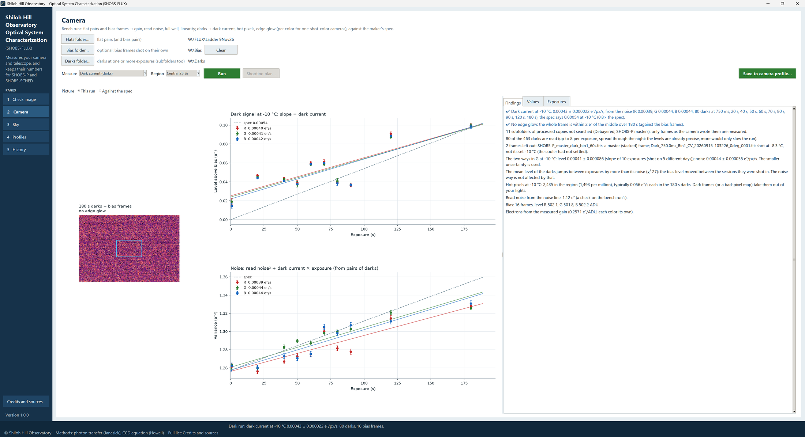

# 6. Camera: the dark run

The dark run measures your camera's **dark current** (the electrons a pixel collects per second with no light), its
**hot pixels** and any **edge glow**, per color for a one-shot-color camera, and per sensor temperature when your
darks were shot at more than one. It reads your **dark library** as you already keep it.

Modern cooled CMOS cameras have very little dark current: a fraction of an electron per pixel in a few minutes at
−10 °C. SHOBS-FLUX is built to measure numbers that small, and to say so honestly when a number is too small to
measure at all.

## What it reads

Point SHOBS-FLUX at the folder of your dark library. It can be laid out either way most people keep one:

- **all in one folder**, darks at one or more exposures together; or
- **one subfolder per exposure** (`20 Sec`, `120 Sec`, `180 sec`…), up to two levels down.

The darks should be at one gain, offset and binning. Bias frames help (in a subfolder, in the same folder, or in a
bias folder of their own) but are not required.

SHOBS-FLUX finds the frames itself and leaves out what does not belong, saying why each time:

- **subfolders of processed copies**: any folder whose name has *Debayer*, *Calibrat*, *Processed*, *Master*,
  *Stack*, *Integrat* or *Registered* in it;
- **master darks** and other processed frames;
- frames that are **not darks or bias frames** (flats, lights);
- frames **cut short in copying** (the file is smaller than its header says);
- darks **shot before the cooler settled**: more than 1.5 °C from their set temperature.

It reads up to eight darks per exposure, spread through the set (more only slows the run), and up to 16 bias frames.
A line says how many were read of how many found.

## Running it

1. On the **Camera** page, set **Measure** to **Dark current (darks)**.
2. Press **Darks folder…** and pick the library's folder.
3. Leave **Region** at **Central 25 %** (amp glow at the edges stays out of the dark current; the edge glow is
   measured separately on whole frames) and press the green **Run**.

The results fill the **Findings**, **Values** and **Exposures** tabs (the Camera page's third tab is
**Exposures** for a dark run: for each exposure its **Frames**, **Level** in ADU with its **±**, **Var e⁻²** from one
pair, the sensor **°C** and when it was **Shot**). The status strip gives the headline, for example *Dark run: dark current at -10 °C 0.00043 ± 0.000022 e⁻/px/s; 80
darks, 16 bias frames.*

## Two ways to the dark current

SHOBS-FLUX measures the dark current two independent ways, and shows both.

- **From the mean level.** The level of each exposure's darks against the exposure: the slope is the dark current.
  It is simple, but the bias level wanders a little between sessions (darks shot on different days), and on a cold
  modern sensor that wander can be as big as the dark signal itself.
- **From the noise.** Dark current is shot noise, so the noise of the darks grows with exposure: noise² = read
  noise² + dark current × exposure. Taking the difference of two darks cancels the fixed pattern and the bias level,
  drift and all, so this way can see a fraction of an electron. It is usually the better of the two.

The more precise of the two is the result. A line gives both (*The two ways in G: …*), and when they disagree a
⚠ says so. *⚠ The darks' level rises faster than their noise* is most likely the bias level creeping up during the
session, or the sensor warming (light would raise both). *⚠ The colors' darks disagree* is the sign of light getting in.

**Too small to measure.** A dark current smaller than twice its own uncertainty is given as an **upper limit**:
*✔ Dark current at −10 °C: too small to measure, at most … e⁻/px/s*. The profile is saved with that upper limit (the
Save window says *at most*), so SHOBS-P and SHOBS-SCHED never count on less dark noise than there may be. A number
is never given that the darks cannot support.

With one exposure only, the bias frames give the zero point; with neither bias frames nor a second exposure, there
is no dark current at that temperature, and the Findings say so.

## The pictures

- **Edge glow:** the longest darks less the bias (or the shortest darks), over the whole frame, shrunk so the hot
  pixels drop out. Amp glow shows as a bright edge or corner.
- **Dark signal:** each exposure's level against its exposure; the slope is the dark current.
- **Noise:** read noise² + dark current × exposure, from pairs of darks.

**Against the spec** (the **Picture** choice) draws the maker's dark-current curve against temperature with your
measured points on it.

## The other findings

- **Hot pixels:** how many in the region and per million pixels, in the longest darks, from a median stack less the
  bias pattern; or *✔ No hot pixels in the region*.
- **Edge glow:** how much more dark signal the edges get than the middle, or *✔ No edge glow: the whole frame is
  within 2 e⁻ of the middle over …*.
- **Read noise from the noise line:** a check on the bench run's read noise.
- **Several temperatures:** each temperature is measured on its own, and with two or more at least 4 °C apart, *✔
  The dark current doubles every … °C*. The Check image page then reads the dark current at each frame's own
  temperature from that curve.
- **The gain used:** electrons are worked out with the camera profile's gain. With no gain known at all, a ⚠ says
  1 e⁻/ADU was assumed and every number is in ADU really: run the bench first.

## Saving

**Save to camera profile…** works as for the bench run (chapter 5): each value **Now** and **Measured** (dark
current, hot pixels, edge glow), **Keep the values you typed yourself**, **Save**.

> **Tip:** A dark library at your usual exposures (say 60, 120 and 180 s) and your usual set temperature is all it
> needs. Add a second temperature (your summer one) when you have it, for the doubling temperature.

---

Previous: [5. Camera: the bench run](05-bench-run.md) · Next: [7. Sky](07-sky.md)
