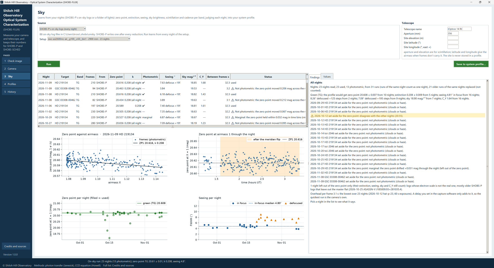
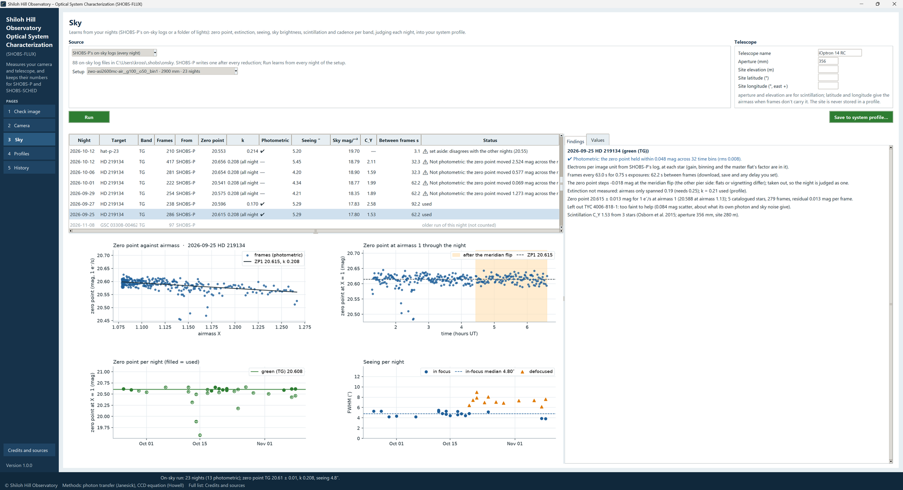

# 7. Sky

The Sky page learns what your **telescope, camera and sky** do from ordinary nights of photometry. For each band
(green, red or blue for a color camera; each filter for a mono camera) it measures:

| Value | What it is |
|---|---|
| **Zero point** | The magnitude of a star that gives 1 e⁻/s through your system at airmass 1. Bigger is better: it is your system's light grasp, and it falls as mirrors get dirty. |
| **Extinction (k)** | How much fainter stars get per unit of airmass, in magnitudes. Your sky's clarity. |
| **Seeing** | Star size (FWHM) in arcseconds, in focus, and separately for each defocus you use. |
| **Sky brightness** | In magnitudes per square arcsecond (bigger = darker), from the dark-Moon nights first. |
| **Scintillation (C_Y)** | Young's coefficient: how much the atmosphere's twinkle adds to your noise. |
| **Time between frames** | Seconds lost between frames: download, saving and any delay set in the capture program. |

These are the numbers SHOBS-SCHED needs for its S/N and its verdicts (chapter 1), and the ones the History page
follows over time.

The Sky page never needs a special night: every night you reduce adds to it.

## Where the nights come from

Pick the **Source** at the top left.

**SHOBS-P's on-sky logs (every night).** SHOBS-P 2.2.19.1 and later write an **on-sky log** in the data folder's
`onsky` folder after every reduction: for every frame, every catalogued star's light, its brightest pixel, the sky,
the airmass, the seeing and the focus. The line under the Source says how many logs there are. Nothing more is
needed: SHOBS-FLUX learns from all of them.

**A folder of lights.** For nights SHOBS-P has not reduced, or if you do not use SHOBS-P. Press **Folder of
lights…** and pick **one night's raw lights of one field** with catalogued stars (any field: a transit, a variable,
an open cluster). Then:

- **Color**: which color of a one-shot-color camera to measure (**Green (TG)**, **Red (TR)** or **Blue (TB)**). A
  mono camera uses each frame's **FILTER** instead.
- **These frames are**: **Photometry**, or **Imaging (astrophotography)** for guided long exposures focused for
  pictures. An imaging run's star size is kept apart as *Seeing, imaging focus*, never mixed with photometry seeing.
  Its zero point, extinction and sky count as usual.

SHOBS-FLUX measures the folder itself and writes the same kind of on-sky log, so both sources are learned from in
exactly the same way. It uses the frames' plate solution (ASIAIR writes one); without one it matches the first frame
to the catalog by itself, from the RA and Dec, pixel size and focal length in the header. It asks VizieR for the
field's catalog magnitudes once (APASS DR9, and Gaia DR3 for the rest), so this needs the internet. Every light is
measured; only a folder of more than 600 lights is cut down, to runs of frames in a row spread through the night. A
frame whose stars cannot be found, or where fewer than 30 % of them show (clouds), is left out with a line saying so.

A folder run is a look until you **Save** it: only a saved folder run goes into the run history.

## The setup and the telescope

**Setup.** When the logs hold more than one telescope or camera setting, pick yours: each setup is a camera
setting with a focal length. A log belongs to a setup when its focal length is within 3 % (ASIAIR writes the
plate-solved focal length, which moves a few mm from night to night).

**Telescope.** Type:

- **Telescope name**, as you want to see it (for example *iOptron 14 RC*). It names the system profile;
- **Aperture (mm)** and **Site elevation (m)**, for the scintillation;
- **Site latitude (°)** and **Site longitude (°, east +)**, only needed when your frames do not carry the airmass.

The site is never stored in a profile: each SHOBS program keeps its own.

## Running it

Press the green **Run**. The busy bar runs while the logs (or the folder) are read and judged. The status strip
gives the headline, for example *On-sky run: 23 nights (13 photometric); zero point TG 20.61 ± 0.01, k 0.208, seeing
4.8″.*

## How nights are judged

For every frame and every catalogued field star, SHOBS-FLUX works out a zero point: the star's catalog magnitude
plus 2.5 log₁₀ of its electrons per second. It uses every catalogued star in the field, whatever role the star had
in the reduction (comp, check or none), but never the target. Stars are **set aside**, each with the reason, when:

- they are **saturated** (their brightest pixel at or over the camera profile's linear limit) in more than a fifth of
  the frames;
- their **catalog magnitude disagrees** with the rest by more than 0.15 mag and 4 robust sigma (a wrong catalog value,
  or two stars blended);
- they **vary**: their own scatter is more than three times the rest's.

The frames' zero points are then fitted against airmass: ZP(X) = ZP₁ − k (X − 1).

**Photometric?** A night is **photometric** when its zero point holds steady: the fit's residuals, in 10-minute
bins, stay within 0.025 mag rms. Thin cloud or haze moves them. Photon noise and scintillation average out in the
bins, so a noisy but clear night still passes. A night that just fails is **marginal**.

**What each night counts for.**

- The **zero point** and the **extinction** come from photometric nights only, each night once. A night that
  disagrees with the others (3-sigma, across nights) is **set aside**, not averaged in.
- The **extinction** needs an airmass span of at least 0.25 in the night and a sensible slope. A night without one
  uses the profile's measured k, or a typical value for the band, and says which.
- **Seeing, sky, scintillation and the time between frames** count from every usable night, photometric or not.
- **Seeing** is kept apart for defocused nights. A night is **defocused** when its median FWHM is over 7″ or more
  than 2.2 times the night's best in-focus run; when the same night also has an in-focus run, the defocus is named
  by the focuser offset (*defocus +125*).
- **Sky brightness** comes from the darkest nights (Moon under 25 % lit) when there are any.
- **The time between frames** is the **lowest** run's: a delay set in the capture program only ever adds.

**Re-runs.** Only the newest log of each night, target and band counts. If you reduce a night again in SHOBS-P, the
new log replaces the old one, which is listed in grey as *older run of this night (not counted)*. A log that cannot
be read is listed with ✖ and why. A log written by a newer SHOBS-P than this SHOBS-FLUX can read says *update
SHOBS-FLUX; the file is fine*.

## The nights table

Each night's row:

| Column | What it is |
|---|---|
| **Night** | The evening's date (*imaging* for an imaging run). |
| **Target** | The field, as the log names it. |
| **Band** | TG, TR, TB (a color camera's green, red or blue pixels) or a mono camera's filter. |
| **Frames** | Frames used. |
| **From** | SHOBS-P (its on-sky log) or FLUX (a folder of lights). |
| **Zero point** | That night's zero point at airmass 1. |
| **k** | The night's own extinction, or the one used and where it came from. |
| **Photometric** | ✔, *marginal*, or — (not photometric). |
| **Seeing ″** | Its FWHM in arcseconds, with *defocused*, *defocus +125* or *imaging* when so. |
| **Sky mag/″²** | Its sky brightness. |
| **C_Y** | Its scintillation coefficient. |
| **Between frames s** | Seconds lost between its frames. |
| **Status** | What the night was used for (*used*), or its worst finding (*⚠ set aside: …*). |

Hold the pointer on a heading for what its column means.

## The pictures and the findings

**Pick a night** in the table for its pictures on the left:

- that night's **zero point against airmass**, with the fitted line (its slope is the extinction);
- its **zero point through the night**, which shows cloud or haze as dips;
- **every night's zero point**, the chosen night marked;
- **every night's seeing**.

On the right, the **Findings** tab says what the run found (and, for the picked night, what that night says: its
stars set aside and why, its photometric test, its extinction). The **Values** tab lists every value the system
profile would get, **Now** and **Measured**.

## Saving to the system profile

Press **Save to system profile…**. The window lists each value, **Now** and **Measured**, per band. The note *The site
is never stored in a profile: each app keeps its own.* is a reminder. Tick **Keep the values you typed yourself
(don't replace them)** if you have typed some. Press **Save**; the status strip says *✔ System profile … saved.*

The system profile is named from the telescope name, focal length and camera. The same telescope name and camera
with a focal length within 3 % is the same profile: it keeps its name and its focal length. If another profile for
this camera at this focal length has a different telescope name, a ⚠ in the window says so.

Every night SHOBS-FLUX uses goes into the run history once, for the History page.

> **Tip:** Run the Sky page now and then, after a few new nights, and save. The zero point and extinction then
> follow your system through the seasons, and the History page shows it.

## When things go wrong

| You see | What it means |
|---|---|
| *No on-sky log files yet in …* | SHOBS-P has not written any: it needs 2.2.19.1 or later, and a reduction. Or use A folder of lights. |
| A night with — under Photometric | Cloud or haze: its zero point drifted. It still counts for seeing, sky and C_Y. |
| *⚠ set aside: …* | That night's zero point disagrees with the others (dew on the optics? the wrong flat?). |
| No zero point for a band | No photometric night in that band yet. |
| *⚠ On-sky run: the folder of lights gave no night to learn from.* | The folder's frames could not be matched to the catalog, or clouds hid the stars. The Findings say which. |
| A catalog failure | VizieR did not answer. Try again later (a mirror is asked when the main one is down). |

---

Previous: [6. Camera: the dark run](06-dark-run.md) · Next: [8. Profiles](08-profiles.md)
