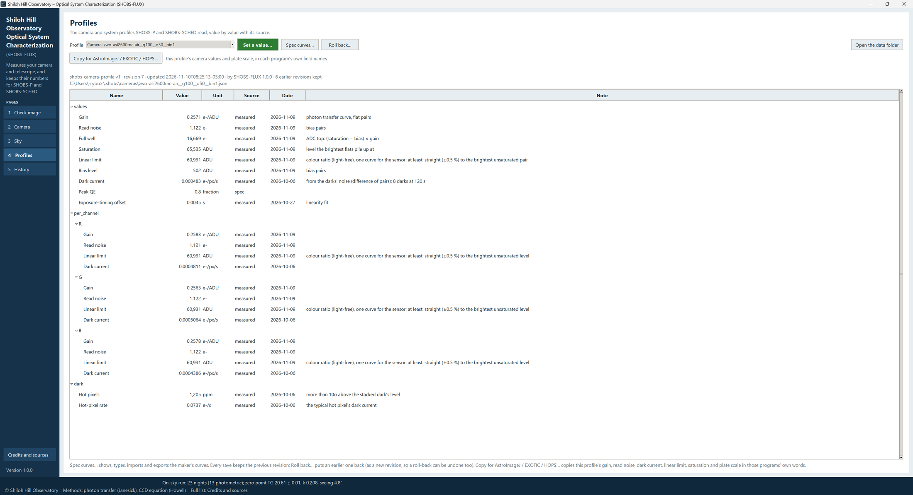
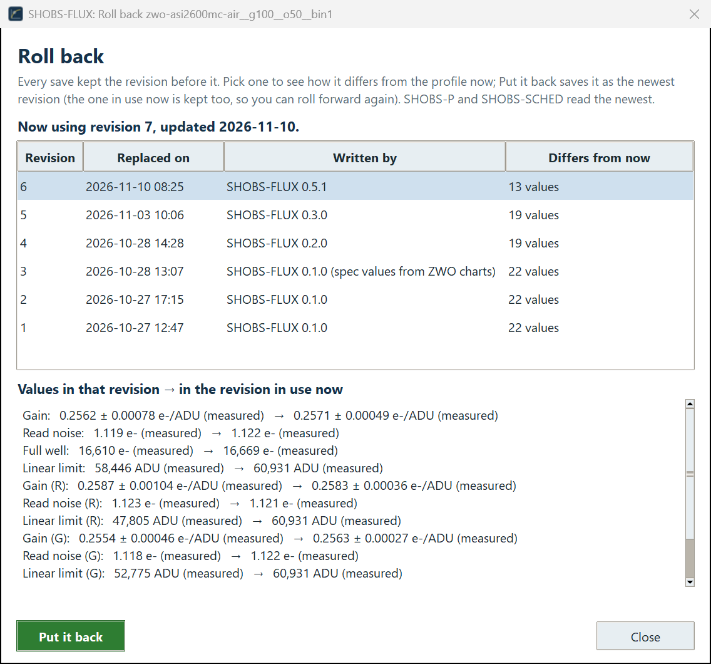
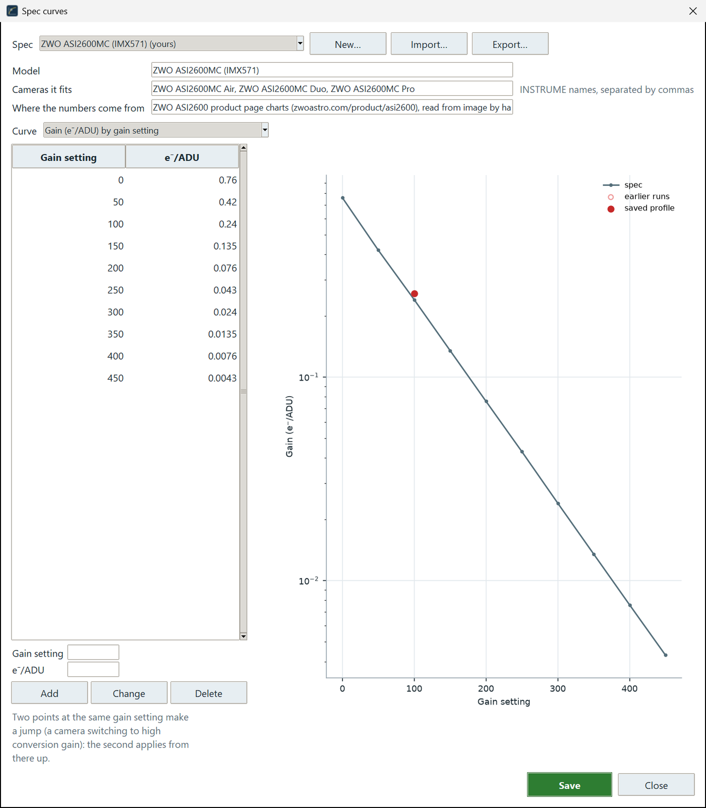
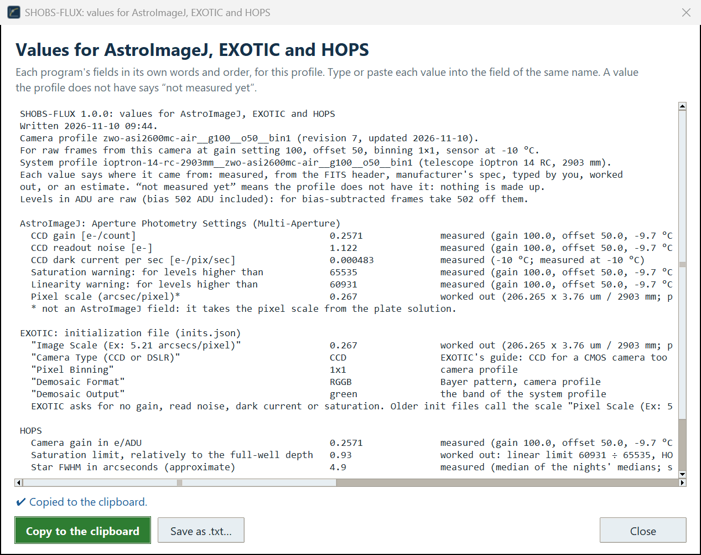

# 8. Profiles

The Profiles page shows the **camera and system profiles** SHOBS-P and SHOBS-SCHED read, value by value with its
source, and the makers' **spec curves**. Here you can type a value of your own, put an earlier revision back, and
copy a profile's values for AstroImageJ, EXOTIC or HOPS.

## Looking at a profile

Pick a profile under **Profile**. The list holds every file in the data folder: *Camera: …*, *System: …* and
*Spec: …*. A camera profile's name is the camera, gain, offset and binning
(`zwo-asi2600mc-air__g100__o50__bin1`); a system profile's is the telescope and focal length, then the camera's
(`ioptron-14-rc-2903mm__zwo-asi2600mc-air__g100__o50__bin1`).

The line under the buttons gives the profile's format, its **revision**, when it was updated and by what, how many
earlier revisions are kept, and its file's place on disk. The table lists every value:

| Column | What it is |
|---|---|
| **Name** | The value, grouped: the camera as a whole, then each color; for a system profile, the telescope, the plate scale, each band and the cadence. |
| **Value** | The number (or the text, for a telescope name). |
| **Unit** | e⁻/ADU, e⁻, ADU, mag for 1 e⁻/s, mag/airmass, arcsec… |
| **Source** | *measured*, *header*, *spec*, *estimate*, *you* or *worked out* (chapter 1). |
| **Date** | When it was measured or typed. |
| **Note** | How it was measured, and from what: *photon transfer curve, flat pairs*; *colour ratio (light-free), one curve for the sensor …*; *10 nights (2026-09-25 to 2026-11-08)*. |

Nothing on this page changes a profile unless you press **Set a value…** or **Put it back** (and **Save** in
**Spec curves…** changes only spec files).

**Open the data folder** opens the `.shobs` folder in Explorer.

## Typing your own value: Set a value…

Sometimes you know better than any run: a linear limit you have checked yourself, a gain from a lab test, an
aperture. Pick the value's row in the table (a row with a unit), press **Set a value…** and type the number. The
window explains: *It is saved with the source "user" and wins over header, spec and estimates until a run measures
it.*

The value is saved with the source *you* and today's date, and the message says *✔ Saved …; the previous revision is
in the history folder.* Values worked out from the one you changed are worked out again (the full well from the
gain, say), and the message names them.

A value you typed is kept when you save a later run, if you tick **Keep the values you typed yourself (don't replace
them)** in its Save window.

## Revisions and Roll back…

Every save, whether a bench run, a dark run, a Sky run or a typed value, keeps the revision before it in the data
folder's `history` folder. Nothing is ever lost.

Press **Roll back…** to see them. The **Roll back** window lists the earlier revisions: **Revision**, **Replaced on**,
**Written by** and **Differs from now**. Pick one, and the lower table shows each value **in that revision → in the
revision in use now**. Press **Put it back** to use it again.

A roll-back is saved as a **new** revision (the one in use now is kept too), so it can itself be undone, and the
revision number only ever goes up. The status strip says *✔ … rolled back to revision ….* SHOBS-P and SHOBS-SCHED
always read the newest revision.

> **Example.** Before SHOBS-FLUX 0.6.1, the linear limit was found by a looser rule (±1 %). Running the bench again
> on the same ladder and saving brought the new value in as a new revision; Roll back… could still put the old one
> back.

## Spec curves…

The makers' curves: gain, read noise, full well and dynamic range against the gain setting, and dark current against
the sensor temperature, as their charts show them. SHOBS-FLUX uses them for values nothing has measured yet (the
*spec* tag), and draws them under your measured points (**Against the spec** on the Camera page).

Press **Spec curves…**. The **Spec curves** window lists your spec files and the ones SHOBS-FLUX comes with. Pick a
**Spec**, then a **Curve**: its points show in a list and a plot, with what you have measured on it.

- **Add**, **Change** or **Delete** a point by hand (from the maker's chart), then press **Save**. A built-in spec you change is
  saved as **your own copy**, which SHOBS-FLUX then uses in its place.
- **New…** starts a spec for a camera SHOBS-FLUX does not know.
- **Import…** takes a spec file someone has shared (it is checked first); **Export…** writes the one on screen to a
  file to share.
- Two points at the same gain setting make a **jump**: a camera switching to its high-conversion-gain mode (the
  second applies from that setting up).

## Copy for AstroImageJ / EXOTIC / HOPS…

If you also reduce with another program, it wants some of these numbers too. Pick a camera or system profile and
press **Copy for AstroImageJ / EXOTIC / HOPS…**. The window gives one block per program, in that program's **own
field names and order**, ready to type or paste:

- **AstroImageJ**, its *Aperture Photometry Settings*: *CCD gain*, *CCD readout noise*, *CCD dark current per sec*,
  the saturation and linearity warning levels, and the pixel scale.
- **EXOTIC**, its initialization file: *Image Scale (Ex: 5.21 arcsecs/pixel)*, the camera type, binning, and the
  demosaic format and color for a color camera. (EXOTIC asks for no gain, read noise or dark current.)
- **HOPS**: *Camera gain in e/ADU*, the saturation limit as a share of HOPS's own 65,535 limit, the star FWHM,
  HOPS's own binning (2 for a color camera) and the telescope and camera names.

Every value says where it came from (*measured*, *from the FITS header*, *manufacturer's spec*, *typed by you*,
*worked out*, *estimate*). A value the profile does not have says *not measured yet*, never a made-up number. The
dark current is read at the profile's sensor temperature; the plate scale is that of the camera's (binned) pixel. A
camera profile alone has no telescope, so it has no plate scale (unless exactly one system profile uses that
camera).

As soon as the window opens, it is all on the clipboard (*✔ Copied to the clipboard.*), so whatever was on the
clipboard before is replaced. **Copy to the clipboard** copies it again; **Save as .txt…** keeps a copy.

> **Tip:** This is where the measured gain goes into AstroImageJ. It reads EGAIN from the header otherwise, and the
> header's figure is the driver's, not your camera's (chapter 5).

## What is in a profile

A camera profile holds, for the camera as a whole and for each color: gain, read noise, bias level, full well,
saturation, linear limit, dark current (with its temperature curve), hot pixels, edge glow, the exposure-timing
offset and the peak QE.

A system profile holds the telescope (name, aperture, focal length, central obstruction, mirrors and their
reflectivity, corrector and filter transmission, the camera's QE in the band: most of these are only for the system
report, chapter 9), the plate scale, and per band the zero point, extinction, seeing in focus and per defocus, the
imaging seeing, sky brightness and scintillation, and the cadence.

The profiles are small JSON files in a shared format (version 1), defined in `shobs_profile.py`, one file copied
unchanged into each SHOBS program, so SHOBS-P and SHOBS-SCHED read the profiles exactly as SHOBS-FLUX writes them. You do not need to open them; if you do, never edit them by hand while a
SHOBS program is running.

---

Previous: [7. Sky](07-sky.md) · Next: [9. History and the system report](09-history.md)
