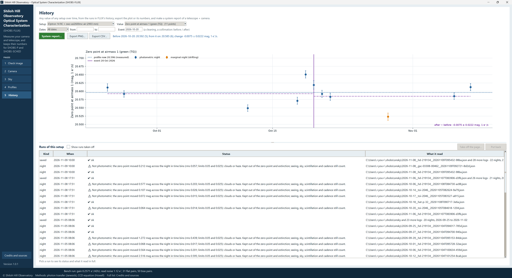
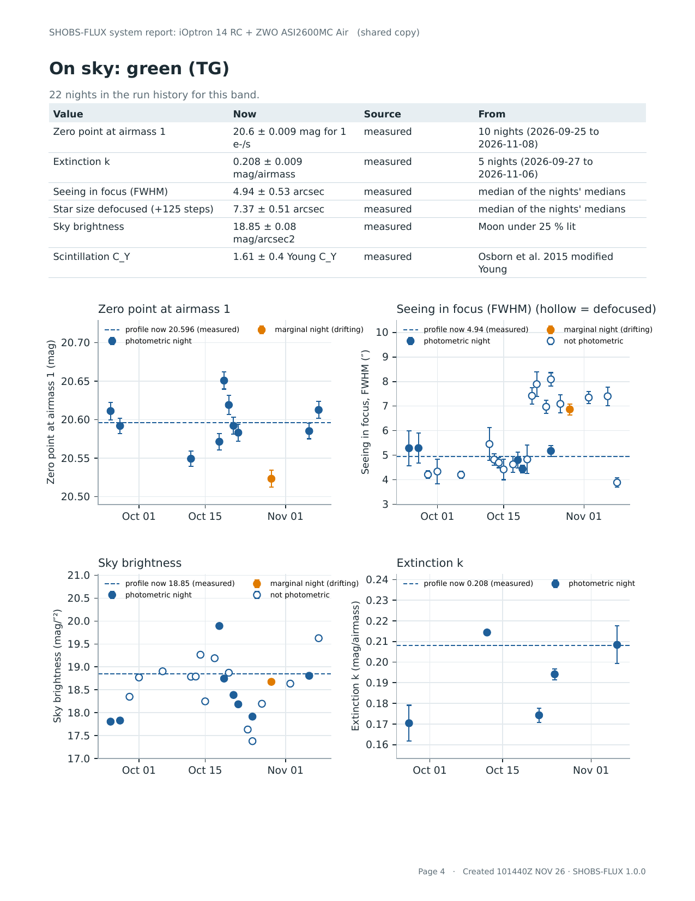

# 9. History and the system report

Every run SHOBS-FLUX makes goes into its **run history**: each bench run, dark run, Sky night and Check image, with
its values, its date and what it read. The History page draws any value of any setup over time, and makes the
**system report**, one PDF of a telescope and camera.

Use it to answer questions like: *Is my zero point falling?* (dirty mirrors, a dewed corrector, a failing coating)
*Did the collimation help the seeing?* *Has my camera's read noise changed?* *What is the sky like here in winter?*

## Picking what to see

- **Setup:** a **system** (a telescope with a camera) or a **camera** on its own. Systems carry the on-sky values;
  cameras carry the bench and dark values.
- **Value:** anything the setup has a history for: zero point, extinction, seeing in focus and defocused, sky
  brightness, scintillation, the time between frames, gain, read noise, full well, linear limit, dark current…
  Each choice says how many points it has.
- **Dates:** **All dates**, **Last 30 days**, **Last 90 days**, **Last year**, or **These dates** with a **from** and
  **to** (type them as *2026-10-30*, *30 Oct 2026*, *30Oct26* or *10/30/2026*).
- **Event** (optional): the date of something that may have changed the system, such as *a cleaning, a collimation*.
  The plot then shows the **mean before and after** it, so you can see whether it made a difference.

## The plot

Each night or run is a point with its error bar. On-sky points from **marginal** nights (the zero point drifted a
little) and **non-photometric** nights are marked differently from photometric ones, so a cloudy night does not pass
for a change in the system. The profile's value now is drawn as a line, with its uncertainty, and for a camera value
the **maker's spec** at your gain setting is drawn too.

**Export PNG…** saves the plot as a picture, stamped with the date-time group. **Export CSV…** saves its numbers
for a spreadsheet: date, value, uncertainty, unit, the band or color, the target, whether photometric, and the run
each came from.

## The runs of this setup

Below the plot, **Runs of this setup** lists every run: **Kind** (*bench*, *darks*, *night*, *saved* for a saved Sky run, *check*), **When**, **Status** (its
worst finding in a few words) and **What it read** (the folder, or the on-sky log and night). Pick a run to see it
in full under the list.

**Take off the page…** takes a run off the History page: a bad night, a test, a run with the wrong folder. Its values
leave the trend plots and the system report. **Nothing is deleted.** Tick **Show runs taken off** to see them (in
grey) and **Put back** to bring one back.

Taking a run off the page does not change a profile. To leave a night out of the system profile, run the Sky page
again (the night is judged again) and save.

## The system report

Press **System report…** for one PDF of a telescope and camera, to keep or to send to someone. Pick the **System**,
then:

- **For the photon budget:** the optics the report compares your measured throughput with. Type the ones you know:
  **Central obstruction** (diameter fraction), **Mirrors in the light path**, **Reflectivity of each mirror**,
  **Corrector / reducer transmission**, **Filter transmission in the band**, **Camera QE in the band**. A blank box is
  assumed (a typical value), and the report says so wherever an assumed value is used. What you type is kept in the
  system profile for next time. The camera QE in the band, if blank, is worked out from the maker's QE curve.
- **Event date (optional):** as on the page, for the before / after split.
- **Shared copy:** tick it for a copy to send. It leaves out the site (latitude, longitude, elevation) and every file
  location on your computer, and dates the PDF in UTC.

Press **Make report…** and choose where to save it.

The report's pages:

1. **Summary:** the setup, the dates of the data, the key numbers.
2. **Camera:** every camera value with its source, the other values it has had (SHOBS-FLUX's own measurement beside
   one you typed, say), and the maker's spec.
3. **On sky:** per band, the numbers and their nights plotted.
4. **Throughput:** your measured zero point against the **photon budget**: how many photons a star of a given
   magnitude delivers to your aperture, through the obstruction, mirrors, corrector, filter and the camera's QE (for
   a color camera, only its share of the pixels). The ratio says how much of the light your system really turns into
   counted electrons, against what the optics should allow.
5. **Over time:** the zero point and seeing, with the before / after split.
6. **Methods and caveats:** how each number was measured, and what it cannot tell you.

> **Tip:** Make a report after each season, and keep them. Side by side they show your system's year.

---

Previous: [8. Profiles](08-profiles.md) · Next: [10. The busy bar and messages](10-busy-bar-and-messages.md)
