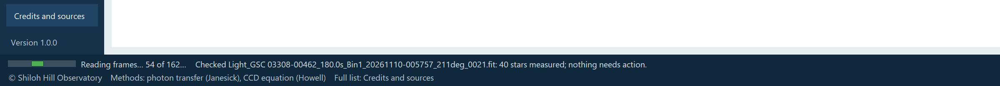

# 10. The busy bar and messages

SHOBS-FLUX tells you what it is doing in three ways: a **busy bar** while it works, **message lines** when it has
finished, and the **status strip** along the bottom of the window for the latest news.

## The busy bar

Whenever SHOBS-FLUX is working on something that takes more than a moment, a busy bar appears at the **lower left of
the window**, in the status strip. A small **green** bar moves back and forth on the navy strip, and the words beside
it say what the program is doing. It is the same busy bar as in SHOBS-P and SHOBS-SCHED.

You see it while SHOBS-FLUX is:

| Job | The words say, for example |
|---|---|
| Checking a frame (Check image) | *Checking Light_HD 219134_30.0s….fit…*, then *Reading the frame…*, *Measuring the sky…*, *Finding stars…*, *Measuring stars…* |
| A bench run | *Bench run on Ladder 9Nov26…*, then the frames and pairs as they are read and measured |
| A dark run | *Dark run on Darks…* |
| A Sky run of SHOBS-P's logs | *On-sky run…* |
| A Sky run of a folder of lights | *Looking at the folder of lights…*, then *On-sky run on Lights…*: *Reading the folder…*, *Asking the star catalog…*, *Matching the stars to the catalog…*, *Writing the log…* |
| Making the system report | *Making the system report…* |
| Judging older runs again (History page, once after an update) | *Judging older runs by today's rules…* |

A job's words change step by step. The bar itself moves back and forth; it never fills up. You can keep looking at
other pages while it works. When the job is done, the bar disappears and the result appears.

## Messages: ✔, ⚠ and ✖

Every message, on a page or in the status strip, carries an **icon as well as a color**, so it reads the same to
everyone:

| Icon | Color | Meaning | Example |
|---|---|---|---|
| **✔** | blue | Done, or good news | *✔ Camera profile zwo-asi2600mc-air__g100__o50__bin1 saved.* |
| **⚠** | dark amber on pale yellow | Needs your attention: a result to doubt, a step to take | *⚠ Read-noise-limited: the sky gives only …* |
| **✖** | red | Something did not work, or a frame has a real problem | *✖ No stars found to measure (clouds, a calibration frame, or very out of focus?).* |
| (none) | black | A plain note | *3 field stars saturated …* |

⚠ and ✖ are kept for things that matter. Routine things are plain notes: a few saturated field stars, a night that
was cloudy, a pair the panel flickered on that SHOBS-FLUX corrected.

## The status strip

The status strip along the bottom has two lines. The first is the latest news:

- at start, *Data folder: C:\Users\…\.shobs* (or a ✖ if the shared profile code failed its own check);
- after a run, its headline (*Bench run: gain 0.2571 e⁻/ADU …*, *On-sky run: 10 nights …*);
- after a save, *✔ Camera profile … saved.* or *✔ System profile … saved.*;
- when a newer release is out, *SHOBS-FLUX … is available*, with a link to its release notes (chapter 2).

The second line is the credits line: *© Shiloh Hill Observatory · Methods: photon transfer (Janesick), CCD equation
(Howell) · Full list: Credits and sources*.

## Common messages

| Message | What to do |
|---|---|
| *✖ Check image failed (…). Details are in …\flux.log.* | The frame could not be read. Chapter 12. |
| *✖ … failed (…). Details are in …\flux.log.* | A run stopped with an error. The log has the details; please report it (chapter 12). |
| *⚠ Pick a profile first.* / *⚠ Pick a value in the list first (a row with a unit).* | On the Profiles page, pick a profile and a row before Set a value…. |
| *⚠ A camera profile with this name already exists: see the Profiles page.* | Save as starting camera profile does not overwrite: run the bench, or type values on the Profiles page. |
| *✖ "…" is not a number.* | Set a value… wants a plain number (commas are fine). |
| *✖ The run history could not be written (is another FLUX open?).* | Close the other SHOBS-FLUX window. |
| *⚠ On-sky run: the folder of lights gave no night to learn from.* | See chapter 7. |

---

Previous: [9. History and the system report](09-history.md) · Next: [11. Credits and citing](11-credits-and-citing.md)
