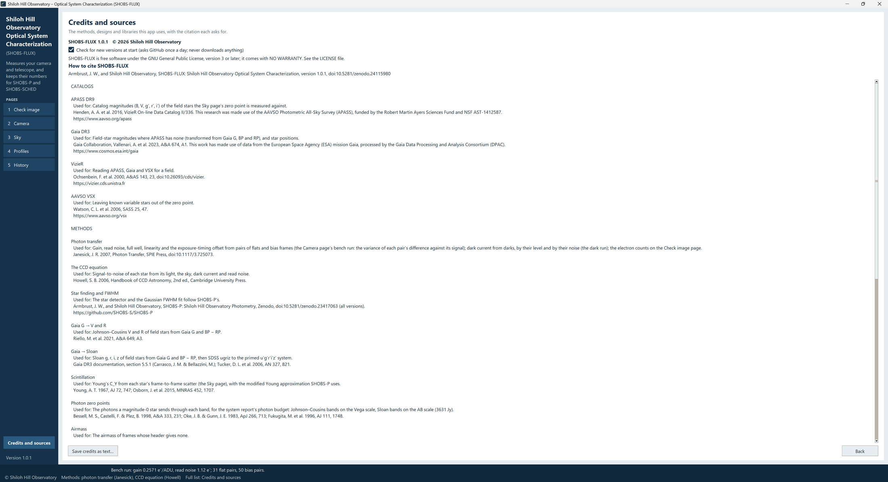

# 11. Credits and citing

## The Credits and sources page

Press **Credits and sources** at the bottom of the sidebar. The page lists:

- the version and copyright (*SHOBS-FLUX 1.0.1   © 2026 Shiloh Hill Observatory*);
- **Check for new versions at start (asks GitHub once a day; never downloads anything)**, the switch for the
  new-version check (chapter 2);
- the license line;
- **How to cite SHOBS-FLUX**;
- every **catalog**, **method**, piece of **design and code** and **library** SHOBS-FLUX uses, each with what it is used for, its
  citation or acknowledgement, and its web address.

**Save credits as text…** writes the whole page to a text file, for a paper's acknowledgements.

### What SHOBS-FLUX stands on

**Catalogs:** APASS DR9 (the field-star magnitudes the zero point is measured against), Gaia DR3 (magnitudes where
APASS has none, and positions), VizieR (reading them), and AAVSO VSX (leaving known variables out).

**Methods:** photon transfer (Janesick 2007) for gain, read noise, full well, linearity and dark current; the CCD
equation (Howell 2006) for signal-to-noise; SHOBS-P's star finding and FWHM fit; the Gaia to Johnson–Cousins and
Sloan transformations (Riello et al. 2021; Gaia DR3 documentation); scintillation (Young 1967; Osborn et al. 2015);
photon zero points for the system report (Bessell, Castelli & Plez 1998; Oke & Gunn 1983; Fukugita et al. 1996);
airmass (Kasten & Young 1989); the Moon's phase (Astropy).

**Design and code:** SHOBS-SCHED's window frame, colors, busy bar and launchers; the camera makers' published charts
for the spec curves.

**Libraries:** Python and Tk (with SQLite for the run history), NumPy, SciPy, Astropy and Matplotlib.

The full citations are on the page.

## How to cite SHOBS-FLUX

If SHOBS-FLUX's numbers go into your work (a paper, an AAVSO or ExoClock report, a talk), please cite it. The page
gives the line to use:

> Armbrust, J. W., and Shiloh Hill Observatory, SHOBS-FLUX: Shiloh Hill Observatory Optical System
> Characterization, version 1.0.1, doi:10.5281/zenodo.24115980

The DOI is SHOBS-FLUX's Zenodo concept DOI: it stands for every version and resolves to the newest. Once ASCL lists
SHOBS-FLUX, its ASCL entry is added to the line. The repository's `CITATION.cff` gives the same; GitHub shows it as
**Cite this repository**.

Please also cite the catalogs and methods your numbers rest on: for a zero point, APASS DR9 and Gaia DR3; for gain
and read noise, Janesick's *Photon Transfer*.

If you also use them, cite **SHOBS-P** by its concept DOI, `10.5281/zenodo.23417063` (every version), and
**SHOBS-SCHED** by its DOI, `10.5281/zenodo.23674791`.

## The license

SHOBS-FLUX is free software under the **GNU General Public License, version 3 or later**. It comes with **no
warranty**. You may use it, share it and change it; if you share a changed copy, it must carry the same license and
its source. The full text is in the `LICENSE` file.

© 2026 Shiloh Hill Observatory.

---

Previous: [10. The busy bar and messages](10-busy-bar-and-messages.md) · Next: [12. Troubleshooting](12-troubleshooting.md)
